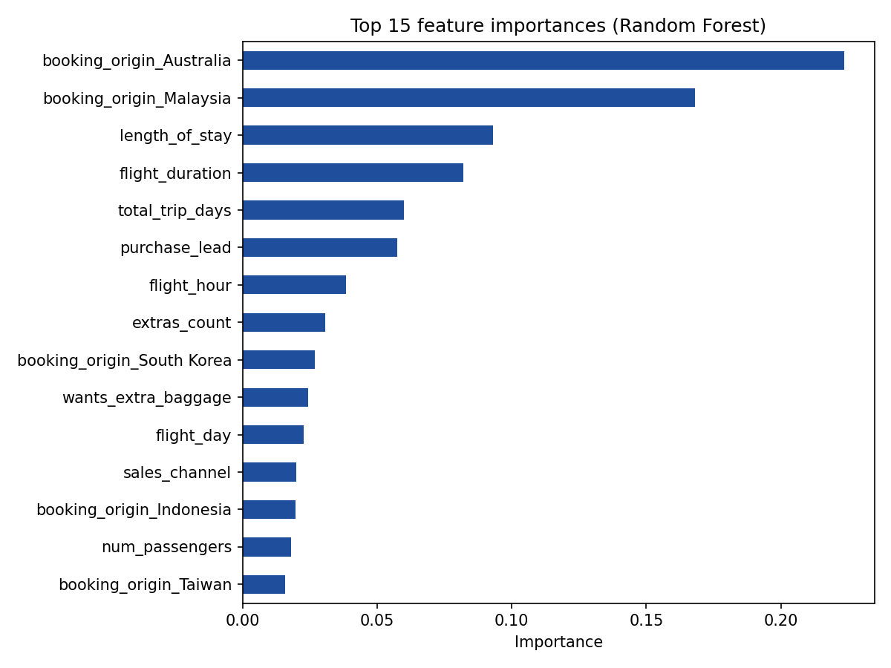

# Customer Booking Prediction

Machine learning model to predict whether airline customers complete a booking. Covers data cleaning, feature engineering, a tuned Random Forest, ROC AUC evaluation, and feature importance analysis (Python, scikit-learn).

> Based on a Forage job-simulation task. This is a practice project and not official work for any company.

## Problem
Customers research flights long before they arrive at the airport, so airlines need to identify likely buyers early. This project predicts `booking_complete` from customer and flight information and identifies which factors contribute most to the model's predictions.

## Dataset
- 50,000 customer booking records, 14 columns (`customer_booking.csv`)
- Target: `booking_complete` (1 = booking completed, about 15% of rows)
- Features include purchase lead time, length of stay, flight day and hour, flight duration, number of passengers, sales channel, trip type, booking origin and extras requested (baggage, seat, meals)

## Approach
1. **Cleaning:** removed 719 duplicate rows, converted `flight_day` to numbers and encoded `sales_channel` and `trip_type`.
2. **Feature engineering:** created `extras_count`, `is_weekend_flight` and `total_trip_days`; grouped rare `booking_origin` countries into "Other" (top 15 kept) and one-hot encoded origin.
3. **Split:** stratified 80/20 train/test split, since only about 15% of customers book.
4. **Modelling:** Random Forest with `class_weight='balanced'`, tuned with 5-fold stratified cross-validation (`GridSearchCV`, scored on ROC AUC).
5. **Evaluation:** the held-out test set was used once at the end.
6. **Interpretation:** Random Forest feature importance, checked with permutation importance on the test set.

## Results
| Metric | Value |
|---|---|
| Cross-validated ROC AUC | 0.760 |
| Test ROC AUC | 0.758 |
| Recall (bookers) | 0.70 |
| Precision (bookers) | 0.29 |
| F1 (bookers) | 0.41 |



**Key findings**
- The model has moderate predictive power. It's useful for ranking customers by booking likelihood, but not accurate enough for confident individual predictions.
- Booking origin, especially Australia and Malaysia, was the most influential feature group, followed by flight duration and length of stay. Permutation importance on the test set confirms Australia as the strongest single feature.
- Accuracy is not used as the main metric, because about 85% of customers do not book and a model predicting "no booking" for everyone would score the same.
- Feature importance shows which variables the model relies on, not that they cause bookings.

## Limitations and next steps
- Only customer and booking data is used, with no browsing or behavioural history.
- Precision is low (0.29), so many predicted bookers will not book. This suits low-cost targeting, not expensive offers.
- Only Random Forest was tuned. Next steps: gradient boosting (XGBoost or LightGBM), threshold tuning and SHAP values.

## How to run
```bash
git clone https://github.com/<your-username>/<repo-name>.git
cd <repo-name>
pip install -r requirements.txt
jupyter notebook Customer_Booking_prediction.ipynb
```
Keep `customer_booking.csv` in the same folder as the notebook. The grid search can take a few minutes.

## Project structure
```
├── Customer_Booking_prediction.ipynb   # analysis notebook
├── customer_booking.csv                # dataset
├── feature_importance.png              # importance chart
├── Customer_Booking_Summary.pdf        # one-slide summary
├── requirements.txt
└── README.md
```

## Author
Aflah T · [LinkedIn](https://www.linkedin.com/in/aflaht)
